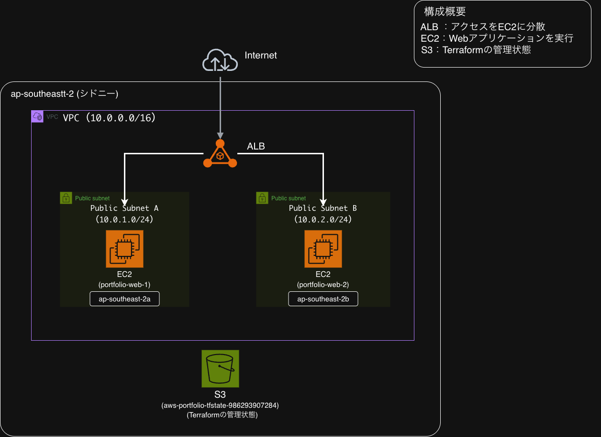

# AWS高可用性Webサーバー構築ポートフォリオ

## 1. プロジェクト概要
AWSとTerraformを使用して、Webサーバー2台とApplication Load Balancer（ALB）を備えたWeb環境を構築しました。

## 2. 構築目的
- AWSのネットワーク構成を実践的に理解する
- ALBによる負荷分散と障害時の動作を検証する
- Terraformを使用してインフラをコードで管理する

## 3. 使用技術
- AWS：VPC、EC2、ALB、セキュリティグループ、S3
- OS：Amazon Linux 2023
- Webサーバー：Nginx
- IaC：Terraform
- バージョン管理：Git / GitHub

## 4. システム構成
インターネットからのHTTP通信をALBで受け付け、異なるアベイラビリティゾーンに配置した2台のEC2へ振り分ける構成です。

## 5. 動作検証
- ALBのターゲットグループでEC2が2台ともHealthyであることを確認
- EC2を1台停止した際、正常なターゲットが1台になったことを確認

## 6. 今後の改善予定
- CloudWatchによる監視設定
- 構成図の追加
- HTTPS対応

## AWS構成図

